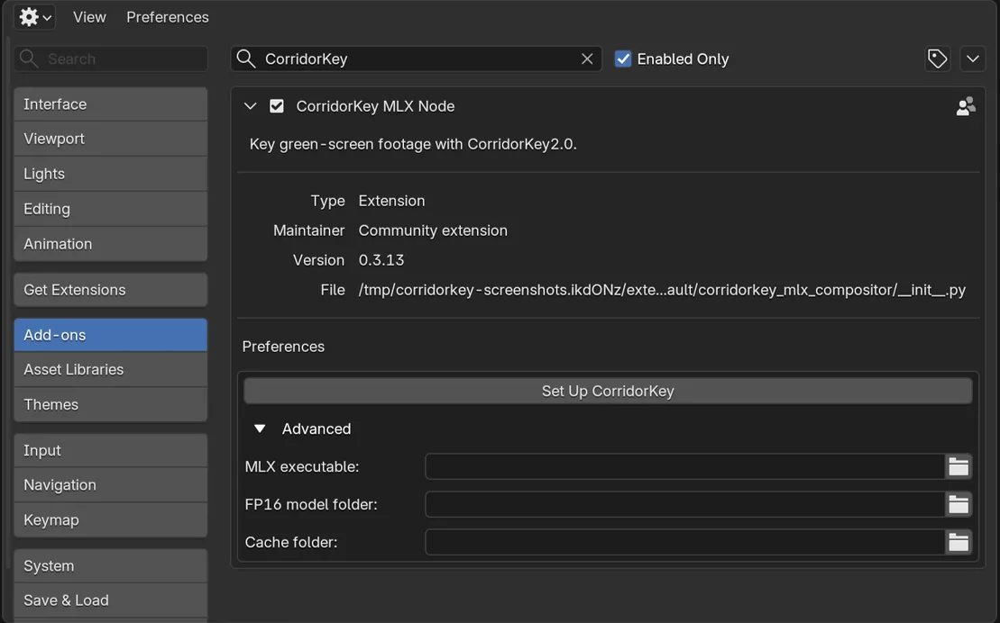
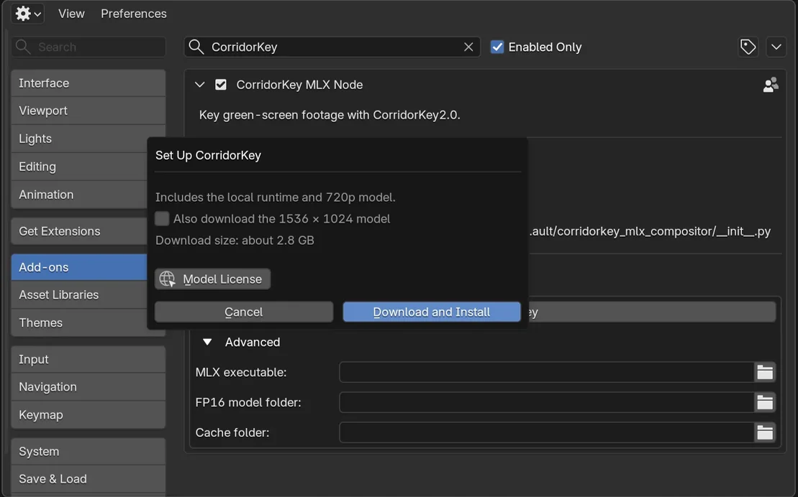

# Setup

Install the extension ZIP via **Preferences → Get Extensions → Install from Disk**.
In **Preferences → Add-ons**, expand **CorridorKey MLX Node** and click **Set Up CorridorKey**. To install both profiles in one pass, check **Also download the 1536 × 1024 model** before clicking **Download and Install**. Automatic setup requires Apple Silicon, macOS 26 or later, and Blender's **Allow Online Access** setting. A fresh install downloads about 2.8 GB for the runtime and 720p model, or about 4.1 GB with both models. Setup stores the runtime and models in Blender's per-extension user folder. Subsequent analysis runs locally.

If you already have a working backend, use the executable and model folder fields under **Advanced**. Clear both fields to use automatic setup. The **Cache folder** override is also under **Advanced**. Unsaved projects use the extension's local analysis cache.

## Use the node

1. In the scene compositor or a Sequencer strip's Compositor modifier, choose **Add → Keying → CorridorKey2.0 (MLX)** and connect its **Image** input. The editable **Start Frame** and **End Frame** fields fill from the strip's visible range or the linked Image node's media. For other graphs, they use the scene range. The bake fits the source into the selected model's frame without stretching it.
2. Before analysis, the **Image** output previews the source. Under **More → Alpha Hint Settings**, connect a rough matte to **Alpha Hint**. The hint appears as a translucent white overlay. **Alpha Hint Confidence** defaults to 0.8. Set it to 0 to skip the hint during analysis. **Hint Frames** defaults to **First Frame**, which samples the hint at **Start Frame**. Choose **All Frames** to sample an animated matte across the analysis range. **Despill Strength** under **More** controls spill removal in the baked **Image** and **Despilled Foreground**. It defaults to 1.0. Set it to 0 to skip spill removal. **Screen** selects the green or blue channel. To apply new settings to an existing bake, click **Clear Bake**, then **Analyze**. The **Garbage Mask** darkens excluded areas in the preview. **More → Additional Outputs** contains Matte, Despilled Foreground, Raw Foreground, and Edges.
3. Click **Analyze**. The node shows frame counts as it bakes, analyzes, and keys. Connect its **Image** output to the **Foreground** input of an **Alpha Over** node, or to **Group Output → Image** to replace a Sequencer strip's image.
4. Click **Clear Bake** to return to the source preview before analyzing again. The cached files stay on disk by default. Enable **Delete Cache Files on Clear Bake** under **Advanced** in the add-on preferences to remove them as well. Undo can't recover deleted files, and other saved blend files may still need them. If a job fails, look for `analysis.log` in the job folder within the cache directory. The default cache is `corridorkey-cache` next to the saved blend file.

## Model resolutions

Both model resolutions use mixed FP16. The **1280 × 720** setting bakes into a 1280 × 720 canvas and the backend pads it to 1280 × 768 for inference. The image input can bake larger or smaller sources at the selected working resolution.

For the **1536 × 1024** setting, click **Download 1536 × 1024 Model** in the add-on preferences. It adds the profile to your active model folder and reuses matching weights from the installed 720p profile. With the 720p model already installed, the additional download is about 1.33 GB. A 16:9 source fits into this canvas at 1536 × 864, with space above and below.

Native 1920 × 1080 needs a 1920 × 1152 graph. Native 3840 × 2160 needs a 3840 × 2176 graph. Those profiles would need to be converted and validated for the MLX runtime, or supplied by the model maintainer. Then the extension would need to expose them.

The node reads the analysis cache during playback and render. Keep the cache with the project. The cache uses a new folder for each analysis, so you can remove earlier folders once any blend files that reference them have been retired.

