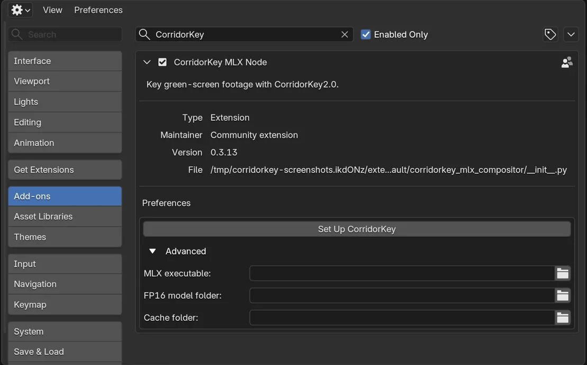
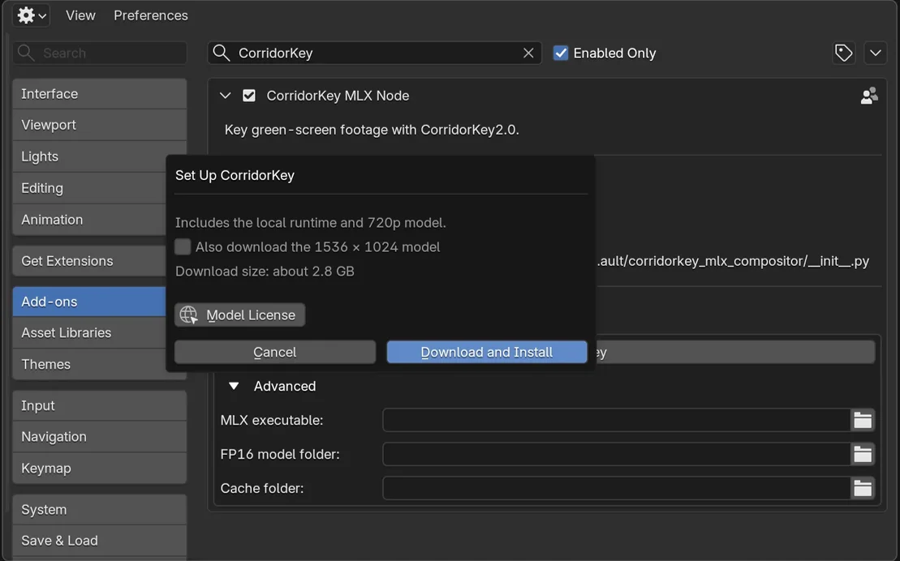

# Setup

Install the experimental extension ZIP in Blender 5.3 or later via **Preferences → Get Extensions → Install from Disk**. It uses the same extension ID as the Mac release, so installing this build replaces that copy and reuses its installed MLX runtime and models.

## Windows with NVIDIA (experimental)

Use 64-bit Windows, an NVIDIA RTX 30-series or newer GPU, a driver compatible with CUDA 12.8, Python 3.12, Git, and FFmpeg. This build uses a manually installed copy of the [upstream CorridorKey 2.0 CUDA runtime](https://github.com/nikopueringer/CorridorKey2.0#setup). Its weights take about 5 GB. The extension does not install Python, PyTorch, or the weights on Windows.

In PowerShell:

```powershell
git clone https://github.com/nikopueringer/CorridorKey2.0.git
cd CorridorKey2.0
py -3.12 -m venv venv
.\venv\Scripts\python.exe -m pip install torch==2.9.1 torchvision==0.24.1 --index-url https://download.pytorch.org/whl/cu128
.\venv\Scripts\python.exe -m pip install -r requirements.txt
.\venv\Scripts\python.exe scripts\download_weights.py
.\venv\Scripts\python.exe -c "import torch; assert torch.cuda.is_available(); print(torch.cuda.get_device_name(0))"
```

In **Preferences → Add-ons → CorridorKey Node (Experimental)**, set **CUDA Python** to `venv\Scripts\python.exe` and **CorridorKey 2.0 folder** to the checkout containing `infer.py`. If FFmpeg is missing from Blender's PATH, set **FFmpeg executable** to the full path to `ffmpeg.exe`.

Start with a few frames of green-screen footage in the **scene compositor** at a modest render resolution such as 1280 × 720. Add **Keying → CorridorKey2.0 (CUDA)** and follow the steps below. The node uses the scene's render size including the resolution percentage. Its input and output plates are scene-linear EXR in Linear Rec.709. It exposes **Image**, **Matte**, **Raw Foreground**, and **Edges**. The upstream cutout includes green despill. Blue-screen controls, a separate despilled foreground sequence, and Sequencer strip baking are outside this first Windows build.

For a Windows test report, include the GPU, driver, Blender version, the upstream revision from `git rev-parse HEAD`, and the job's `analysis.log` if it fails. Check frame alignment and alpha, then try canceling a longer analysis and running it again. CUDA inference and Windows cancellation still need a test on actual Windows RTX hardware.

## macOS with Apple Silicon

In **Preferences → Add-ons**, expand **CorridorKey Node (Experimental)** and click **Set Up CorridorKey**. To install both profiles in one pass, check **Also download the 1536 × 1024 model** before clicking **Download and Install**. Automatic setup requires Apple Silicon, macOS 26 or later, and Blender's **Allow Online Access** setting. A fresh install downloads about 2.8 GB for the runtime and 720p model, or about 4.1 GB with both models. Setup stores the runtime and models in Blender's per-extension user folder. Subsequent analysis runs locally.

If you already have a working backend, use the executable and model folder fields under **Advanced**. Clear both fields to use automatic setup. The **Cache folder** override is also under **Advanced**. Unsaved projects use the extension's local analysis cache.

## Use the node

1. In the scene compositor, choose **Add → Keying → CorridorKey2.0** with your platform's **CUDA** or **MLX** label and connect its **Image** input. On Mac, the node also works in a Sequencer strip's Compositor modifier. **Start Frame** and **End Frame** fill from the strip's visible range or the linked Image node's media. For other graphs, they use the scene range. The bake fits the source without stretching it.
2. Before analysis, the **Image** output previews the source. The **Alpha Hint** under **More** adds a translucent white overlay. The **Garbage Mask** darkens excluded areas, including where the two masks overlap.
3. Click **Analyze**. The node shows frame counts as it bakes, analyzes, and keys. Connect its **Image** output to the **Foreground** input of an **Alpha Over** node, or to **Group Output → Image** to replace a Sequencer strip's image.
4. Click **Clear Bake** to return to the source preview before analyzing again. The cached files stay on disk by default. Enable **Delete Cache Files on Clear Bake** under **Advanced** in the add-on preferences to remove them as well. Undo can't recover deleted files, and other saved blend files may still need them. If a job fails, look for `analysis.log` in the job folder within the cache directory. The default cache is `corridorkey-cache` next to the saved blend file.

## MLX model resolutions

The installed 720p FP16 profile has a padded height × width of 768 × 1280. Model graphs use fixed tensor shapes. Image input can bake larger or smaller sources at the selected working resolution.

For the extension's **1536 × 1024** setting, click **Download 1536 × 1024 Model** in the add-on preferences. It adds the profile to your active model folder and reuses weights that match files in the installed 720p profile. A complete 720p install reduces the additional download to about 1.33 GB. 

Native 1920 × 1080 needs a 1152 × 1920 graph. Native 3840 × 2160 needs a 2176 × 3840 graph. Those profiles would need to be converted and validated for the MLX runtime, or supplied by the model maintainer. Then the extension would need to expose them.

The node reads the analysis cache during playback and render. Keep the cache with the project. The cache uses a new folder for each analysis, so you can remove earlier folders once any blend files that reference them have been retired.



